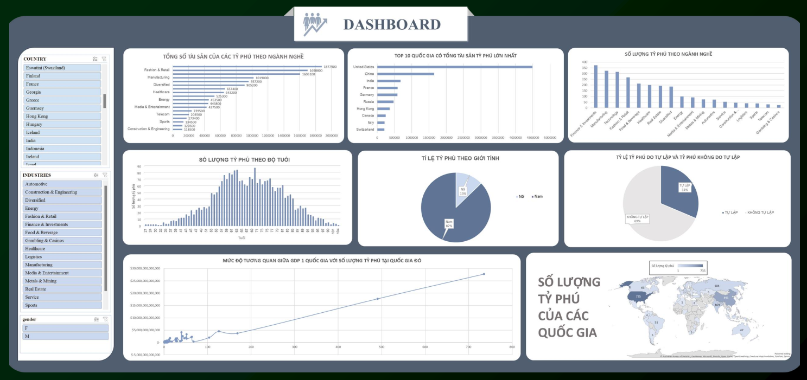

# Global-Billionaire-Analytics
Language: [English](#-english) | [Tiếng Việt](#-tiếng-việt)
---
# 🇬🇧 English
## 1. Project Overview
This project analyzes a global billionaire dataset to examine global wealth distribution, identify the most lucrative industries, evaluate the proportion of self-made versus inherited wealth, and measure the macroeconomic correlation between national GDP and billionaire density across countries.
- **Format:** Group project.
- **Role:** Dashboard Designer – Responsible for building Pivot Tables, conducting statistical correlation analysis, and designing a fully interactive Dashboard using Slicers based on the target analytical questions.
## 2. Tech Stack & Techniques
* **Analytics & Visualization Tool:** Microsoft Excel.
* **Key Technical Skills:**
  * **Pivot Table & Pivot Chart:** Multi-dimensional data aggregation, calculating summary metrics (`SUM`, `COUNT`) across industries, countries, age groups, and genders.
  * **Statistical Formulas:** Applied the `=CORREL()` function to calculate the Pearson correlation coefficient between national GDP and the number of billionaires.
  * **Interactive Dashboard Design:** Connected multi-dimensional Slicers (Country, Industry, Gender) to enable synchronized cross-filtering across the entire report.
## 3. Dataset Summary
* **Scale:** 2,640 global billionaire records.
* **Total Net Worth:** ~$12.2 Trillion USD ($12,206,800M).
* **Key Attributes:**
  * *Demographic & Personal Information:* `personName`, `gender`, `age`, `countryOfCitizenship`.
  * *Business & Financial Metrics:* `finalWorth`, `industries`, `organization`, `selfMade` (True/False).
  * *Macroeconomic Indicators:* `gdp_country`, `cpi_country`, `tax_revenue_country_country`, `population_country`.
## 4. Key Business Question & Insights
* **Question 1:** How is the total wealth of billionaires distributed across different industries?
* **Question 2:** What is the demographic composition (age and gender) of billionaires?
* **Question 3:** What is the ratio between self-made and inherited billionaires?
* **Question 4:** How does the size of a national economy (GDP) correlate with the number of billionaires in that country?
* **Question 5:** Which industry groups have the highest concentration of billionaires?
* **Question 6:** Which countries possess the highest number of billionaires and total billionaire wealth globally?
## 5. Dashboard

## 6. Repository Structure
```text
├── Global Billionaire Dashboard.xlsx       # Complete raw data, Pivot Tables, and Excel Dashboard
├── Global Billionaire Analysis.pdf         # Comprehensive analytical report and findings
├── excel_gbdashboard_screenshot.png        # Screenshot of the Dashboard interface
└── README.md                               # Project documentation and summary
---
# 🇻🇳 Tiếng Việt
## 1. Tổng quan dự án
Dự án phân tích tập dữ liệu các tỷ phú thế giới nhằm khảo sát cấu trúc tài sản toàn cầu, nhận diện các ngành kinh tế tạo ra nhiều của cải nhất, đánh giá cơ cấu tài sản tự lập so với thừa kế, đồng thời đo lường mối quan hệ tương quan giữa quy mô kinh tế vĩ mô (GDP) và mật độ tỷ phú tại từng quốc gia.
* **Hình thức thực hiện:** Dự án nhóm.
* **Vai trò cá nhân:** Dashboard Designer - Chịu trách nhiệm xây dựng Pivot Tables, phân tích tương quan thống kê và thiết kế Dashboard trực quan hóa tương tác hoàn chỉnh bằng Slicers dựa theo các câu hỏi phân tích.
## 2. Công cụ
* **Công cụ phân tích & trực quan:** Microsoft Excel.
* **Kỹ thuật nghiệp vụ chính:**
  * **Pivot Table & Pivot Chart:** Tổng hợp dữ liệu đa chiều, tính toán giá trị gộp (`SUM`, `COUNT`) theo ngành nghề, quốc gia, độ tuổi và giới tính.
  * **Công thức thống kê:** Sử dụng hàm `=CORREL()` đo lường hệ số tương quan Pearson giữa GDP quốc gia và số lượng tỷ phú.
  * **Thiết kế Dashboard tương tác:** Kết nối Slicers đa chiều theo Quốc gia, Ngành nghề, Giới tính giúp lọc dữ liệu đồng bộ trên toàn bộ báo cáo.
## 3. Mô tả dữ liệu
* **Quy mô:** 2.640 hồ sơ tỷ phú toàn cầu.
* **Tổng giá trị tài sản:** ~12,2 nghìn tỷ USD ($12.206.800M).
* **Các thuộc tính chính:**
  * *Thông tin cá nhân & Nhân khẩu học:* `personName`, `gender`, `age`, `countryOfCitizenship`.
  * *Thông tin tài chính & Kinh doanh:* `finalWorth`, `industries`, `organization`, `selfMade` (True/False).
  * *Chỉ số kinh tế vĩ mô quốc gia:* `gdp_country`, `cpi_country`, `tax_revenue_country_country`, `population_country`.
## 4. Các câu hỏi phân tích
* **Câu 1:** Tổng tài sản của các tỷ phú phân bổ theo từng ngành nghề như thế nào?
* **Câu 2:** Cơ cấu nhân khẩu học (độ tuổi và giới tính) của các tỷ phú phân bổ ra sao?
* **Câu 3:** Tỷ lệ giữa tỷ phú tự lập và thừa kế là bao nhiêu?
* **Câu 4:** Quy mô nền kinh tế (GDP quốc gia) có tương quan như thế nào với số lượng tỷ phú của quốc gia đó?
* **Câu 5:** Số lượng tỷ phú phân bổ nhiều nhất ở những nhóm ngành nghề nào?
* **Câu 6:** Những quốc gia nào sở hữu số lượng và tổng tài sản tỷ phú lớn nhất thế giới?
## 5. Dashboard

## 6. Cấu trúc thư mục
```text
├── Global Billionaire Dashboard.xlsx       # File dữ liệu và Dashboard phân tích hoàn chỉnh trên Excel
├── Global Billionaire Analysis.pdf         # Báo cáo phân tích kết quả
├── excel_gbdashboard_screenshot.png        # Ảnh chụp màn hình giao diện Dashboard
└── README.md                               # Tài liệu mô tả tổng quan dự án
